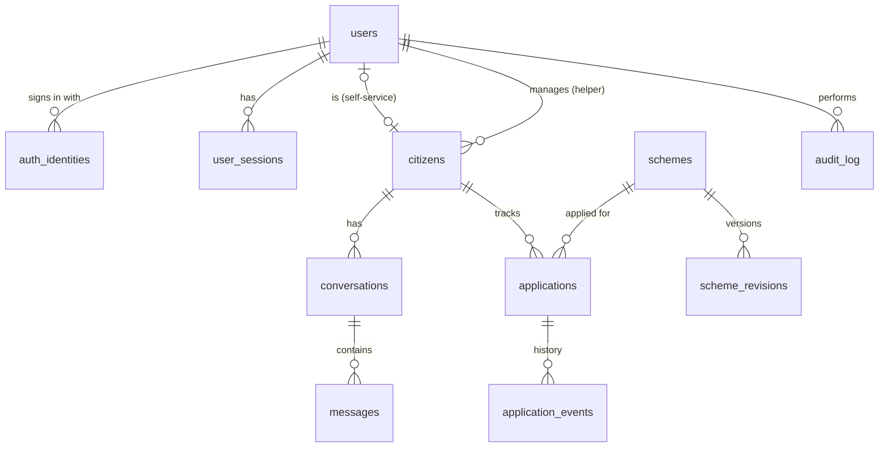

# Saathi web application — architecture

Saathi helps people in India find government welfare schemes they qualify for, prepare the
documents, and track their applications. This document describes the web application: a React
frontend, a Python (FastAPI) backend, PostgreSQL, and Google / mobile-OTP sign-in.

## 1. Users and what they do

| Role | Who | Can do |
|---|---|---|
| **citizen** | A person looking for schemes, signed in with Google or mobile OTP | Chat with Saathi, edit their own profile, see eligible schemes, track their own applications, export or delete their data |
| **helper** | Volunteer or Common Service Centre (CSC) operator | Everything a citizen can, **for the citizens they register** (people without a smartphone or login) |
| **admin** | Project maintainer / data reviewer | Manage scheme data (edit, verify, archive), manage user roles, see usage stats, access any citizen record (audited) |

New accounts are always `citizen`. Admins promote helpers. The first admins come from
`SAATHI_ADMIN_EMAILS` (Google sign-in with a verified email) or the `saathi users set-role` CLI.

## 2. System overview

```
                     Browser (React SPA)                     WhatsApp user
                            │ HTTPS, same origin                  │
                            ▼                                     ▼
                 ┌──────────────────────┐              Meta WhatsApp Cloud API
                 │ nginx (frontend image)│                        │ signed webhook
                 │  /      → static SPA  │                        │
                 │  /api/* → backend     │◄───────────────────────┘ /webhooks/whatsapp
                 └──────────┬───────────┘
                            ▼
 ┌──────────────────────────────────────────────────────────────────────────┐
 │ FastAPI backend (saathi)                                                 │
 │                                                                          │
 │  api/        REST routers: auth, citizens, chat, applications,           │
 │              schemes, admin                                              │
 │  auth/       sessions, CSRF, Google OIDC, OTP + SMS senders, RBAC        │
 │  agent/      conversation loop  ──► agents_core.llm (Azure | Gemini |    │
 │                                     OpenAI-compatible)                   │
 │  schemes/    deterministic rules engine (eligibility never decided       │
 │              by the LLM)                                                 │
 │  db/         SQLAlchemy models, Alembic migrations                       │
 └──────────┬───────────────────────────────┬───────────────────────────────┘
            ▼                               ▼
     PostgreSQL 16                 External: Google OIDC, SMS gateway,
                                   LLM provider
```

**Same origin.** nginx serves the SPA and proxies `/api` to the backend, so the browser talks to
one origin. That allows `SameSite=Lax` HttpOnly cookies, needs no CORS, and keeps tokens out of
JavaScript.

### Backend modules

| Module | Responsibility |
|---|---|
| `saathi.api` | HTTP routers and request/response schemas only; no business rules |
| `saathi.auth` | Session cookies, CSRF, Google OIDC, OTP challenges, SMS senders, `require_role` |
| `saathi.services` | Business logic: citizen access checks, scheme repository, applications, audit log |
| `saathi.agent` | LLM conversation loop (extract facts → rules engine → ask or answer) |
| `saathi.schemes` | Scheme model, rule validation, eligibility engine |
| `saathi.db` | SQLAlchemy models, engine/session setup; migrations in `backend/migrations` |
| `agents_core` | Shared library: switchable LLM providers, PII redaction, WhatsApp channel |

### Frontend modules

| Folder | Responsibility |
|---|---|
| `src/api` | Typed fetch client (cookies + CSRF header), React Query hooks |
| `src/auth` | Current-user context, login page (Google button, phone OTP), route guards |
| `src/features/citizen` | Chat, eligible schemes, profile form, applications tracker, privacy |
| `src/features/helper` | Citizen list and registration; reuses the citizen screens for a selected citizen |
| `src/features/admin` | Scheme list and editor, users and roles, stats dashboard |
| `src/i18n` | UI strings (English, Hindi); chat replies come in the user's own language from the LLM |

## 3. Key flows

### 3.1 Google sign-in (OpenID Connect, authorization code + PKCE)

```
SPA ──GET /api/auth/google/login?next=/me──► backend
backend: create state, nonce, PKCE verifier → signed temp cookie → 302 to Google
Google ──302 /api/auth/google/callback?code&state──► backend
backend: check state, exchange code (+verifier), validate ID token (sig, iss, aud, exp, nonce)
         require email_verified → upsert user + auth_identity(google, sub)
         create session row (sha256 of token) → Set-Cookie saathi_session (HttpOnly) → 302 next
```
`next` is accepted only as a same-site relative path, which prevents open redirects.

### 3.2 Mobile OTP sign-in

```
POST /api/auth/otp/request {phone}
  normalise to +91XXXXXXXXXX → rate-limit (per phone and per IP)
  code = 6 random digits; store HMAC(secret, phone|code), expiry 5 min → send SMS
  always answers 202 (does not reveal whether the number is registered)
POST /api/auth/otp/verify {phone, code}
  latest unexpired, unconsumed challenge; max 5 attempts; constant-time compare
  → consume → upsert user + auth_identity(phone, +91…) → session cookie
```
SMS goes through an `SmsSender` interface:
- `console`: development only; logs the code, and the backend refuses to start with it in production.
- `twilio`: real SMS. Sending to Indian numbers commercially needs a DLT-registered sender and template.

### 3.2b Sign in with WhatsApp (free "reverse OTP")

```
POST /api/auth/whatsapp/start  → code + wa.me link; HttpOnly cookie with a random browser token
person sends "LOGIN <code>" to the bot from WhatsApp (inbound messages are free)
signed webhook → confirm_login(code, sender number)        (Meta has verified the number)
POST /api/auth/whatsapp/poll   → only the browser holding the token gets the session
```
Codes expire after 5 minutes; starts are rate-limited per IP. As with any code-based sign-in, a
person tricked into sending someone else's code signs that person in; the bot's reply warns about this.

### 3.2c Linking sign-in methods

A signed-in user can add a mobile number (`POST /api/auth/link/phone`, OTP-verified) or Google
(`GET /api/auth/google/login?link=true`). A method that already belongs to another account is refused.

### 3.3 Chat turn

```
POST /api/citizens/{id}/chat {message}
  access check (owner | managing helper | admin) → consent required
  Agent.handle(citizen_id, text):
    redact IDs → LLM extracts profile facts → rules engine evaluates verified schemes
    → ask the most useful next question, or list eligible schemes / answer
  DbSessionStore persists: citizen.profile, conversation.state, new messages (redacted text)
  ← {reply, profile}
```

### 3.3b WhatsApp and voice notes

```
signed webhook → WhatsAppCitizenHandler
  "LOGIN <code>"?            → confirm web sign-in (see 3.2b)
  number → user + citizen (same account as a web sign-in with that number)
  no consent yet             → consent notice; "YES"/"हाँ" records consent
  voice note                 → download → ffmpeg → 16 kHz WAV → SpeechProvider.transcribe(language)
  text / transcript          → Agent (DbSessionStore, channel=whatsapp) → reply
  voice note in, voice out   → SpeechProvider.synthesize → OGG/Opus → WhatsApp audio message (+ text)
```
Speech providers (`agents_core.speech`, chosen by `SPEECH_PROVIDER`): Azure AI Speech, Bhashini, or
a self-hosted AI4Bharat Dhruva-Platform server (same API as Bhashini). Audio is never stored; only
the redacted transcript is.

### 3.3c State- and district-wise services

Registration and the details form capture state, district, PIN code and date of birth. State and
district are mirrored into the eligibility profile, and age is always computed from the date of
birth. So:
- a scheme with `level: state, state: <state>` only matches people in that state;
- a rule `{field: district, op: in, value: [lucknow, barabanki]}` targets specific districts
  (district names are stored lowercase);
- scheme cards show "Central scheme" or "<State> scheme".

### 3.4 Scheme data lifecycle

```
YAML seed files ──saathi seed──► schemes (status=draft)
admin edits ──► new scheme_revisions row, version+1, status reset to draft
admin verifies (after checking source_url) ──► status=verified, verified_on, verified_by
agent uses: verified schemes (+ drafts only when SAATHI_INCLUDE_DRAFT_SCHEMES=true)
```

## 4. Database design (PostgreSQL)



| Table | Key columns | Notes |
|---|---|---|
| `users` | `id uuid PK`, `role` (citizen/helper/admin), `display_name`, `email` (unique, nullable), `phone_e164` (unique, nullable), `is_active`, `created_at`, `last_login_at` | One row per person who can sign in |
| `auth_identities` | `id`, `user_id FK`, `provider` (google/phone), `subject`, `created_at`; **unique(provider, subject)** | Google `sub` or E.164 phone. Adding providers needs no schema change |
| `user_sessions` | `id`, `user_id FK`, `token_hash` (unique), `created_at`, `expires_at`, `last_seen_at`, `user_agent` | Only the SHA-256 of the cookie token is stored; deleted on logout |
| `whatsapp_logins` | `id`, `code`, `browser_token_hash` (unique), `phone_e164`, `confirmed_at`, `used_at`, `expires_at`, `ip`, `created_at` | "Sign in with WhatsApp" challenges |
| `otp_challenges` | `id`, `phone_e164`, `code_hash`, `attempts`, `expires_at`, `consumed_at`, `ip`, `created_at` | HMAC of the code; rows older than a day are purged |
| `citizens` | `id`, `user_id FK unique nullable` (self-service), `managed_by_user_id FK nullable` (helper), `display_name`, `profile jsonb`, `language`, `date_of_birth`, `contact_email` (unverified, never used to sign in), `pincode`, `locality`, `address_line`, `consent_version`, `consent_at`, `created_at`, `updated_at` | `profile` = the eligibility profile (age, occupation, …). **No Aadhaar/PAN/bank numbers** |
| `conversations` | `id`, `citizen_id FK`, `channel` (web/whatsapp), `state jsonb`, `created_at`, `updated_at` | `state` = declined fields, questions asked, … |
| `messages` | `id`, `conversation_id FK`, `role` (user/assistant), `content` (PII-redacted), `created_at` | |
| `schemes` | `id text PK` (slug), `name`, `level`, `state`, `ministry`, `tags jsonb`, `summary`, `benefits`, `eligibility jsonb`, `documents jsonb`, `notes jsonb` (conditions the rules cannot express), `how_to_apply`, `apply_url`, `source_url`, `status` (draft/verified/archived), `verified_on`, `verified_by_user_id`, `version`, `updated_at`, `updated_by_user_id` | `eligibility` validated by the same Pydantic rule model as the YAML |
| `scheme_revisions` | `id`, `scheme_id FK`, `version`, `data jsonb`, `changed_by_user_id`, `changed_at` | Full snapshot per edit; supports review and rollback |
| `applications` | `id`, `citizen_id FK`, `scheme_id FK`, `status`, `portal_reference`, `checklist jsonb`, `notes`, `created_by_user_id`, `created_at`, `updated_at`; unique(citizen_id, scheme_id) | `checklist` = {document: ready?} |
| `application_events` | `id`, `application_id FK`, `from_status`, `to_status`, `note`, `actor_user_id`, `created_at` | Status history |
| `audit_log` | `id`, `actor_user_id`, `action`, `entity_type`, `entity_id`, `details jsonb`, `created_at` | Who touched whose data; holds IDs, never profile contents |

Deleting a citizen cascades to their conversations, messages, applications and events. Audit
rows keep only IDs.

Application status flow:
```
interested → documents_ready → submitted → approved → benefit_received
                                         ↘ rejected
(any state → withdrawn)
```

## 5. Security and privacy

| Concern | Control |
|---|---|
| Authentication | Google OIDC (code + PKCE, nonce, verified email) or OTP (HMAC-hashed, 5-minute expiry, 5 attempts, per-phone and per-IP rate limits) |
| Sessions | Opaque random token in an `HttpOnly`, `Secure`, `SameSite=Lax` cookie; DB stores only the SHA-256; 7-day expiry; server-side logout |
| CSRF | Double-submit token: `saathi_csrf` cookie and `X-CSRF-Token` header must match on every state-changing `/api` request |
| Authorization | Role checks plus per-record checks (owner / managing helper / admin). Records the user may not see return 404, so record IDs can't be probed |
| PII | IDs redacted before storage and before any LLM call; no identity-number columns; erasure (`DELETE`) and export endpoints; consent recorded with version and time |
| Auditing | Helper and admin access to citizen records is written to `audit_log` |
| Secrets | Environment / secrets manager only; `.env` is never committed |
| SQL | SQLAlchemy ORM and bound parameters only; no string-built SQL |
| LLM safety | Eligibility decided by rules, not the LLM; prompts forbid inventing schemes or asking for OTPs, money or ID numbers |

Before a public launch: DPDP Act review (notice, consent, retention, grievance officer contact),
HTTPS everywhere, an SMS DLT registration, and backups for PostgreSQL.

## 6. API overview

| Method & path | Who | Purpose |
|---|---|---|
| `GET /api/auth/csrf` | anyone | Issue the CSRF cookie |
| `GET /api/auth/google/login`, `GET /api/auth/google/callback` | anyone | Google sign-in |
| `POST /api/auth/register` | anyone | Create an account: OTP-verified mobile + details + consent |
| `POST /api/auth/otp/request`, `POST /api/auth/otp/verify` | anyone | Phone sign-in (SMS) |
| `POST /api/auth/whatsapp/start`, `POST /api/auth/whatsapp/poll` | anyone | Sign in with WhatsApp |
| `POST /api/auth/link/phone`, `GET /api/auth/google/login?link=true` | signed in | Add a sign-in method |
| `GET /api/auth/me`, `POST /api/auth/logout` | signed in | Current user / sign out |
| `GET /api/me/citizen` | signed in | Own citizen record (created on first call) |
| `DELETE /api/me` | signed in | Delete own account and all own data |
| `GET /api/citizens`, `POST /api/citizens` | helper, admin | List / register managed citizens |
| `GET /api/citizens/{id}`, `DELETE /api/citizens/{id}` | owner, helper, admin | Read / erase a citizen record |
| `PUT /api/citizens/{id}/profile` | owner, helper, admin | Edit eligibility answers |
| `PUT /api/citizens/{id}/details` | owner, helper, admin | Edit name, date of birth, contact email and address |
| `POST /api/citizens/{id}/consent` | owner, helper, admin | Record consent |
| `GET /api/citizens/{id}/eligibility` | owner, helper, admin | Rules-engine results |
| `GET /api/citizens/{id}/messages`, `POST /api/citizens/{id}/chat` | owner, helper, admin | Chat history / send a message |
| `GET /api/citizens/{id}/export` | owner, helper, admin | Download everything held about the citizen |
| `GET, POST /api/citizens/{id}/applications`, `PATCH /api/applications/{id}` | owner, helper, admin | Application tracking |
| `GET /api/schemes`, `GET /api/schemes/{id}` | anyone | Browse active schemes |
| `GET, POST /api/admin/schemes`, `GET, PUT /api/admin/schemes/{id}`, `POST …/verify`, `POST …/archive`, `GET …/revisions` | admin | Scheme data management |
| `GET /api/admin/users`, `PATCH /api/admin/users/{id}` | admin | Roles and activation |
| `GET /api/admin/stats` | admin | Dashboard numbers |
| `GET /healthz` | anyone | Liveness |

## 7. Deployment (Docker Compose)

| Service | Image | Notes |
|---|---|---|
| `db` | `postgres:16-alpine` | Named volume `saathi-pgdata`; not exposed outside the compose network |
| `backend` | `apps/saathi/backend/Dockerfile` | Runs `alembic upgrade head` and `saathi seed`, then uvicorn. Non-root user |
| `frontend` | `apps/saathi/frontend/Dockerfile` | Multi-stage: Node builds the SPA, nginx serves it and proxies `/api` and `/webhooks` |

Only the frontend port is published (`8080` by default); put a TLS-terminating proxy in front for
anything public.

## 8. Not yet built

- Pre-filled application PDFs, DigiLocker, reminders
- Shared rate limiting (Redis) for multi-instance deployments
